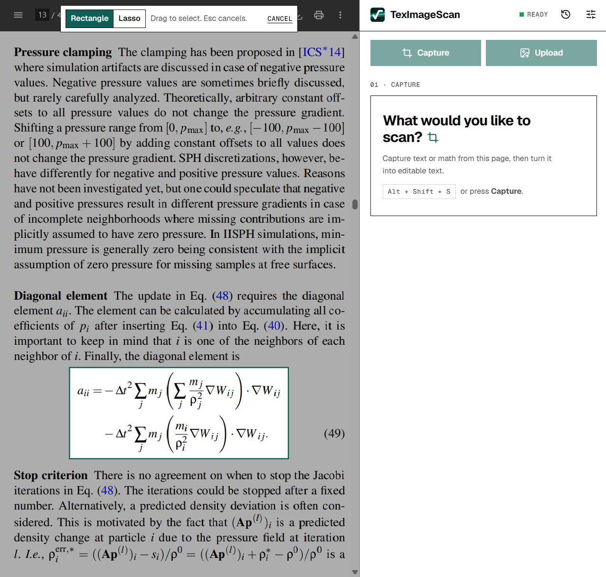
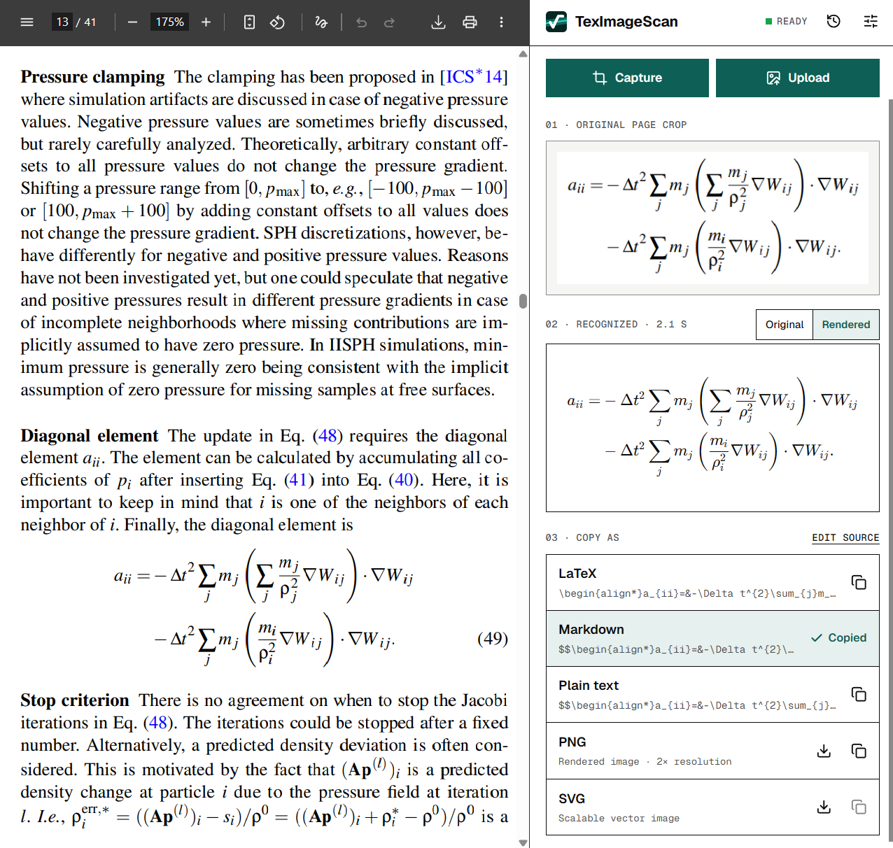

<p align="center">
  
</p>

<h1 align="center">TexImageScan</h1>

<p align="center">
  Turns equations and short passages into editable LaTeX, plain text, or even a vector image.<br>
  Recognition runs on your device. No accounts. No cloud OCR.
</p>

<p align="center">
  
  
  
</p>

## Features

TexImageScan runs in a Chromium browser side panel next to the page you are reading. Capture an equation or a short passage, recognize it locally, then choose the export format you want.

<table>
  <tr>
    <th>1. Capture an equation</th>
    <th>2. Review and copy the result</th>
  </tr>
  <tr>
    <td></td>
    <td></td>
  </tr>
</table>

- Capture equations and passages with a rectangle or freehand lasso, or upload a PNG, JPEG, or WebP image.
- Recognize locally with the TeleOCR model running on your device via WebGPU.
- Recoginition mode **Auto** handles both text and math, but **Settings** also offers explicit **Equation** and **Text with math** modes.
- Review and edit the output source, copy LaTeX, Markdown with math, plain text, or export rendered PNG or SVG images.
- Reopen saved scans, keep editing, or copy several results together. Images and edits stay in local history until you delete them.

## Install

Requires Node.js 24 or later and pnpm 12.15.0:

```sh
pnpm install
pnpm build
```

1. Open `chrome://extensions` in your Chromium browser, enable **Developer mode**, choose **Load unpacked**, and select `.output/chrome-mv3`.
2. Click the TexImageScan toolbar icon to open the side panel.
3. Choose **Download model** to obtain [TeleOCR](https://huggingface.co/stefanj0/TeleOCR-ONNX). The first download is about **1.79 GB** from Hugging Face and stays cached for later use.

Use desktop Chrome or a compatible Chromium browser with hardware acceleration and a GPU supporting WebGPU and `shader-f16`. There is no CPU fallback.

Optional **Capture across tabs** access lets you capture on other websites without clicking the toolbar icon each time. Manage it in **Settings**. Local files require **Allow access to file URLs** in Chrome's extension settings.

## Testing

Install the test browser once, then run type checks, unit tests, the build, browser tests, and package checks:

```sh
pnpm exec playwright install chromium
pnpm verify
```

## Privacy

- Images and recognized text stay on your device. They are saved locally and kept until manually deleted in the history tab.
- Model files use a separate cache, which can be deleted in the settings tab. No telemetry, analytics, or remote OCR API.
- Required website access covers model downloads. Capturing across websites is optional and starts only when you ask.

## Limitations

- OCR can miss text or change symbols. Try to zoom in and use tight crops for better accuracy.
- Full pages and dense layouts can produce incomplete or repetitive output.
- Uploads are limited to 12 MB. Uploaded images and page selections are limited to 8 million pixels.
- If output is cut off, increase the output token limit in the settings tab.

## License

Realeased under [MIT](LICENSE). Bundled dependencies keep their own licenses (see [third-party notices](public/licenses/NOTICE.md) and [attribution sources](public/licenses/SOURCES.md)). TeleOCR weights download separately under Apache-2.0 (see the [model notice](public/licenses/TeleOCR-NOTICE.md)).
